# Praktikum 7: Pemrograman Server-Side dengan PHP

## Identitas Mahasiswa
| Komponen | Keterangan |
| :--- | :--- |
| **Nama Mahasiswa** | MARGENT OUWEN SITOMPUL |
| **NIM** | 312510463 |
| **Mata Kuliah** | Pemrograman Web |
| **Modul Praktikum** | Praktikum 7 — Pemrograman Server-Side dengan PHP |
| **Repository GitHub** | [https://github.com/owensitompul05-ops/Lab7Web_PHP](https://github.com/owensitompul05-ops/Lab7Web_PHP) |

---

## A. Tujuan Praktikum
1. Memahami perbedaan pemrosesan *client-side* dan *server-side*.
2. Mengenali sintaks dasar PHP dan menjalankan file PHP melalui web server lokal.
3. Menggunakan variabel, tipe data, operator, percabangan, perulangan, dan *function*.
4. Menerima dan memproses data dari form HTML menggunakan metode `GET` dan `POST`.
5. Melakukan validasi dan sanitasi input dasar (`htmlspecialchars()`, `filter_var()`, `ctype_digit()`, `preg_match()`) sebelum data ditampilkan atau diproses.
6. Membangun aplikasi sederhana (*Mini Project*) yang menerima, memvalidasi, memproses, dan menampilkan data mahasiswa.

---

## B. Perangkat yang Digunakan
- **Perangkat Keras:** Laptop / PC Windows
- **Kode Editor:** Visual Studio Code
- **Bahasa & Runtime:** PHP 8.3.x, HTML5, CSS3
- **Web Server Lokal:** PHP Built-in Web Server / XAMPP / Laragon
- **Web Browser:** Google Chrome / Microsoft Edge

---

## C. Cara Menjalankan Server Lokal

### Opsi 1: Menggunakan PHP Built-in Web Server (Paling Praktis)
1. Buka terminal / PowerShell di direktori proyek `c:\Users\user\Lab7Web_PHP`.
2. Jalankan perintah berikut:
   ```powershell
   php -S localhost:8000
   ```
3. Buka browser dan akses alamat: `http://localhost:8000/`

### Opsi 2: Menggunakan XAMPP / Laragon
1. Salin folder `Lab7Web_PHP` ke dalam direktori `htdocs` (XAMPP) atau `www` (Laragon).
2. Jalankan layanan **Apache** pada Control Panel XAMPP/Laragon.
3. Buka browser dan akses alamat: `http://localhost/Lab7Web_PHP/`

---

## D. Struktur File Proyek
```text
Lab7Web_PHP/
├── screenshots/         # Folder dokumentasi hasil screenshot setiap latihan & validasi
├── index.php            # Halaman utama (Dashboard & navigasi seluruh latihan)
├── style.css            # Stylesheet antarmuka modern untuk seluruh halaman
├── latihan1.php         # Latihan 1: Menjalankan PHP & menampilkan waktu server
├── latihan2.php         # Latihan 2: Variabel, operator, percabangan & Eksperimen 1 (Rata-rata)
├── latihan3.php         # Latihan 3: Perulangan foreach & array nama mahasiswa (+3 nama baru)
├── latihan4.php         # Latihan 4: Function diskon, format Rupiah (Eksperimen 3), luas & kelulusan
├── latihan5.php         # Latihan 5: Form metode GET & pencarian nama array (Eksperimen 2)
├── cari.php             # Alias untuk Latihan 5 (sesuai nama file di modul)
├── latihan6.php         # Latihan 6: Form metode POST & sanitasi htmlspecialchars()
├── latihan7.php         # Latihan 7: Pengolahan data transaksi barang & perhitungan subtotal
├── mini_project.php     # Mini Project: Aplikasi Formulir Data Mahasiswa (+Eksperimen 4 & 5)
├── form_mahasiswa.php   # Alias untuk Mini Project
└── README.md            # Dokumentasi lengkap laporan praktikum
```

---

## E. Ringkasan Hasil Latihan, Mini Project & Screenshot Output

### 0. Portal Utama Praktikum (`index.php`)
Halaman dashboard utama yang menampilkan identitas praktikan (**MARGENT OUWEN SITOMPUL - 312510463**), informasi lingkungan server PHP, dan akses ke seluruh modul latihan.

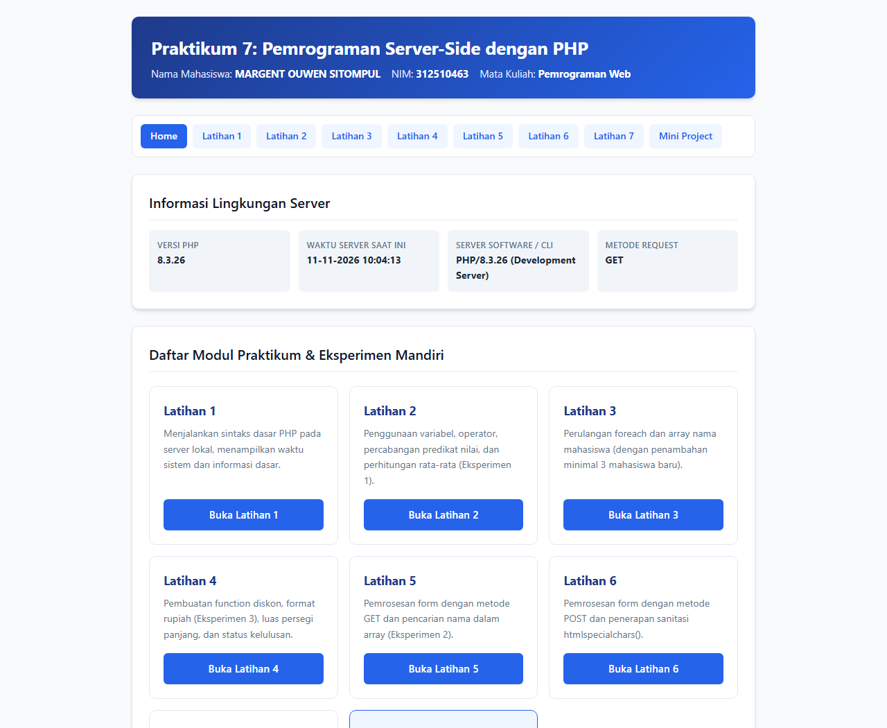

---

### 1. Latihan 1 — Menjalankan PHP (`latihan1.php`)
Menampilkan pesan bahwa PHP berhasil dijalankan di sisi server beserta waktu aktual server menggunakan fungsi `date("d-m-Y H:i:s")`. Kode PHP dieksekusi oleh server dan browser hanya menerima luaran HTML murni.

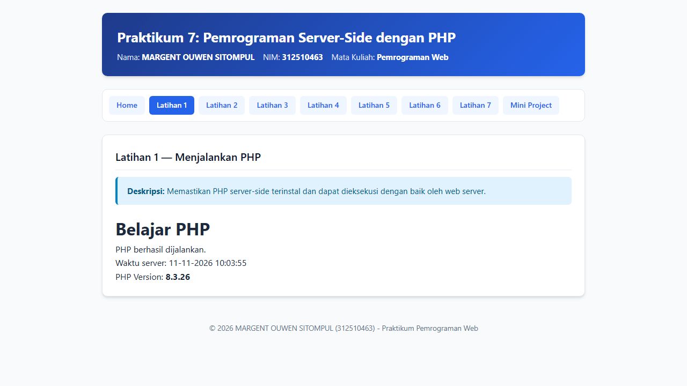

---

### 2. Latihan 2 — Variabel, Operator, dan Percabangan (`latihan2.php`)
Menghitung nilai akhir mahasiswa dari 3 komponen nilai: Tugas (30%), UTS (30%), dan UAS (40%), serta menentukan predikat huruf:
- `>= 85`: Predikat **A**
- `>= 75`: Predikat **B**
- `>= 60`: Predikat **C**
- `< 60`: Predikat **D**

Dilengkapi juga dengan perhitungan rata-rata murni 3 komponen (`($tugas + $uts + $uas) / 3`) sesuai **Eksperimen Mandiri 1** serta form simulasi untuk menguji berbagai kombinasi nilai.

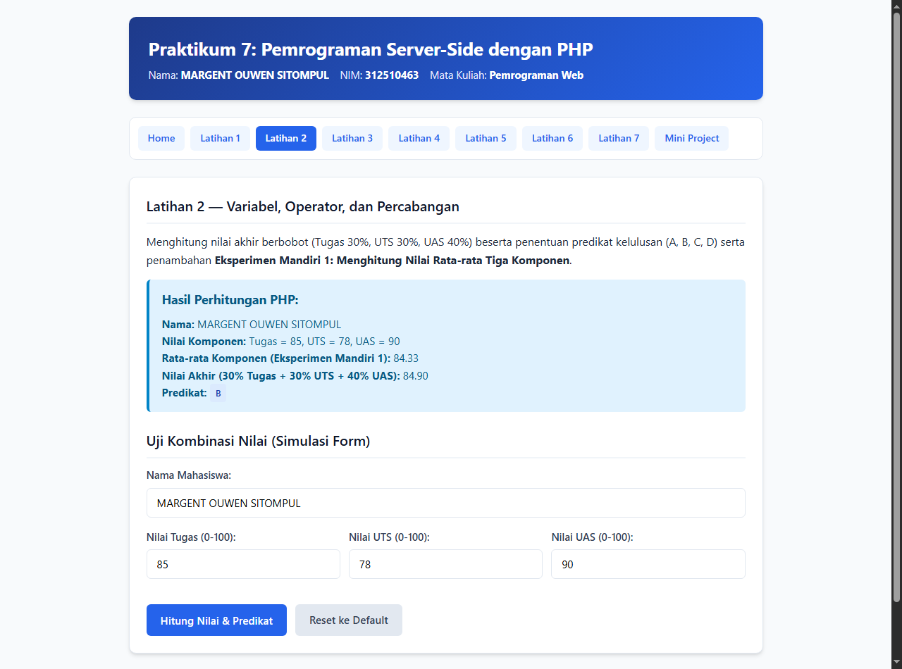

---

### 3. Latihan 3 — Perulangan dan Array (`latihan3.php`)
Menampilkan daftar mahasiswa dari array menggunakan perulangan `foreach` ke dalam elemen `<ol>` dan tabel HTML. Ditambahkan minimal 3 nama mahasiswa baru (`MARGENT OUWEN SITOMPUL`, `Eka Ramadhan`, `Fiona Lestari`) sehingga total menjadi 7 mahasiswa.

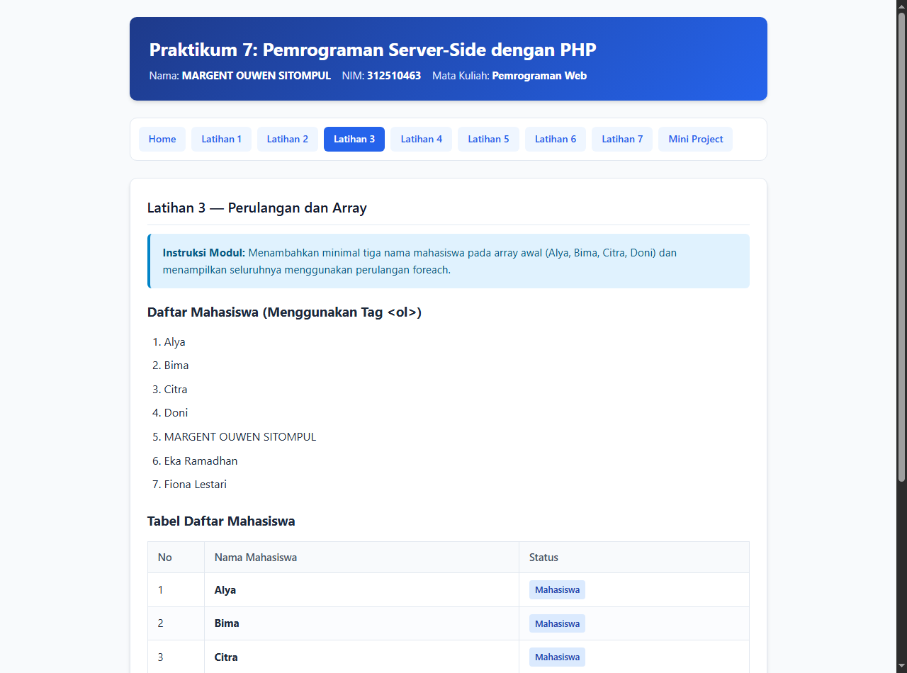

---

### 4. Latihan 4 — Membuat Function (`latihan4.php`)
Mengimplementasikan modularitas kode menggunakan beberapa fungsi:
- `hitungDiskon($harga, $persen)`: Menghitung harga akhir setelah dikurangi potongan persentase diskon.
- `formatRupiah($angka)`: Mengubah angka numerik menjadi format mata uang Rupiah (`Rp 135.000`) (**Eksperimen Mandiri 3**).
- `hitungLuasPersegiPanjang($panjang, $lebar)`: Menghitung luas persegi panjang.
- `tentukanKelulusan($nilai, $kkm)`: Menentukan status `LULUS` atau `TIDAK LULUS`.

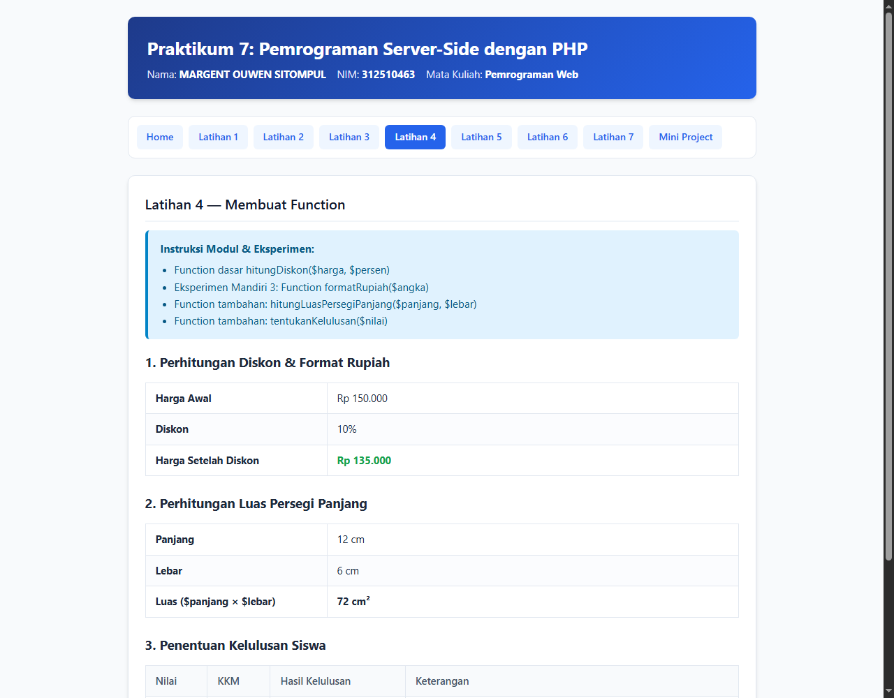

---

### 5. Latihan 5 — Memproses Form dengan GET (`latihan5.php` / `cari.php`)
Memproses pencarian kata kunci melalui parameter URL (`?kata=MARGENT`). Dikembangkan sesuai **Eksperimen Mandiri 2** untuk mencari kecocokan nama mahasiswa pada array data sederhana secara *case-insensitive* menggunakan `stripos()`.

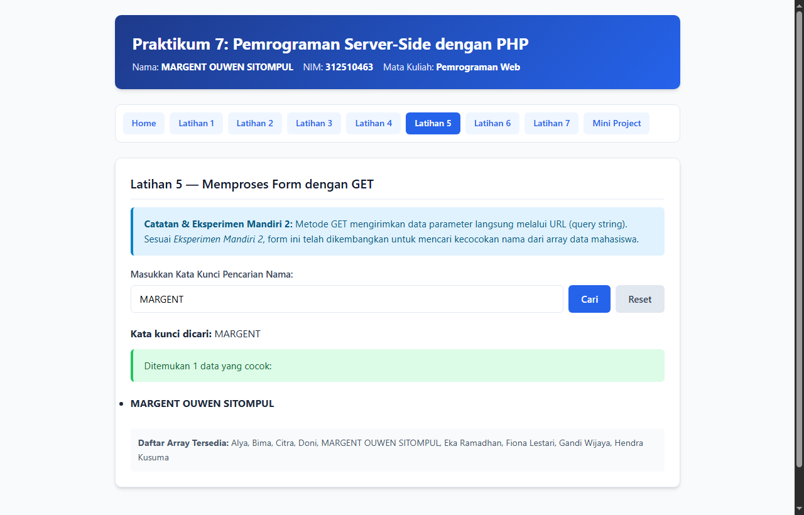

---

### 6. Latihan 6 — Memproses Form dengan POST (`latihan6.php`)
Menerima input Nama dan Program Studi melalui metode `POST`. Melakukan pemeriksaan kolom kosong di sisi server dan mengamankan tampilan output menggunakan `htmlspecialchars($input, ENT_QUOTES, "UTF-8")`.

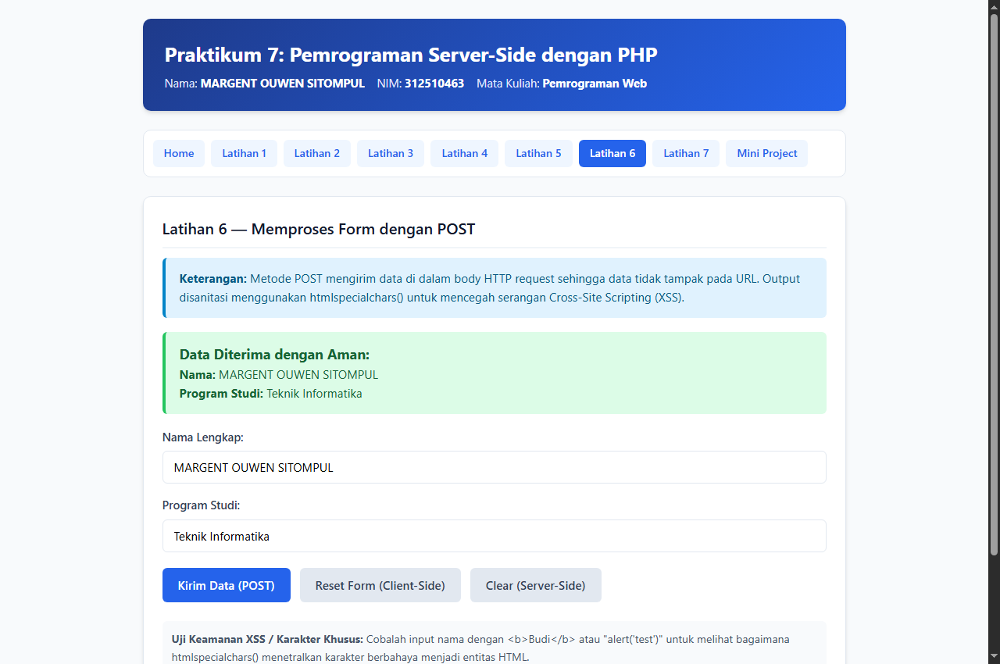

---

### 7. Latihan 7 — Pengolahan Data Sederhana (`latihan7.php`)
Memproses form transaksi pembelian barang (Nama barang, Harga satuan, Jumlah beli). Memvalidasi bahwa harga berupa angka non-negatif (`is_numeric`) dan jumlah berupa bilangan bulat positif (`ctype_digit`), kemudian menghitung subtotal.

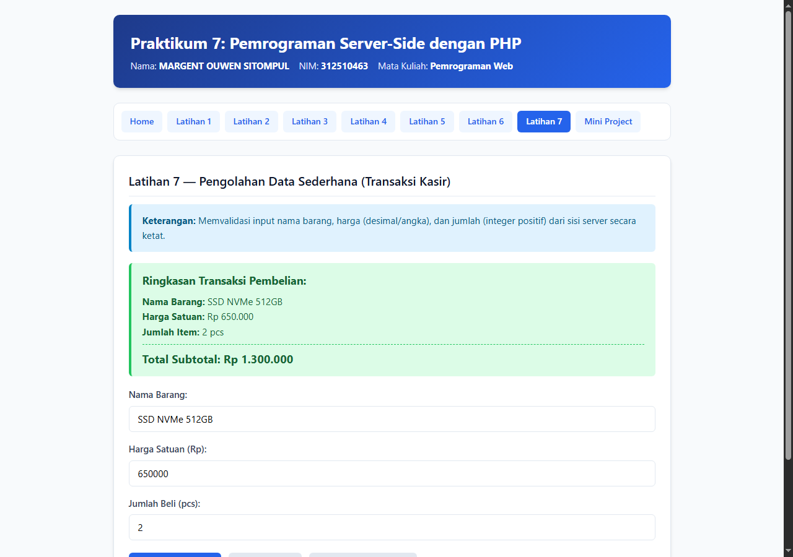

---

### 8. Mini Project — Aplikasi Formulir Data Mahasiswa (`mini_project.php`)
Aplikasi formulir biodata mahasiswa yang memisahkan logika pemrosesan PHP di bagian atas dari tampilan HTML di bagian bawah. Memvalidasi:
- Nama Lengkap (wajib diisi)
- NIM (wajib diisi, hanya berisi angka dan wajib tepat 9 digit sesuai format `312510463` — **Eksperimen Mandiri 4**)
- Program Studi (wajib dipilih)
- Semester (bilangan bulat dalam rentang 1–14)
- Email (format email valid menggunakan `filter_var($email, FILTER_VALIDATE_EMAIL)`)

---

## F. Analisis Kasus Uji Validasi Form (Valid vs Tidak Valid)

### Dua Kasus Input Valid (Berhasil Diproses)

#### Kasus Valid 1 — Input Data Mahasiswa Lengkap dan Sesuai Format (Mini Project)
- **Input:**
  - Nama: `MARGENT OUWEN SITOMPUL`
  - NIM: `312510463`
  - Program Studi: `Teknik Informatika`
  - Semester: `4`
  - Email: `margent.sitompul@mhs.pelitabangsa.ac.id`
- **Hasil Validasi:** Lolos seluruh aturan validasi server-side (`$error` kosong). Sistem menampilkan tabel ringkasan biodata mahasiswa dengan badge NIM valid 9 digit.

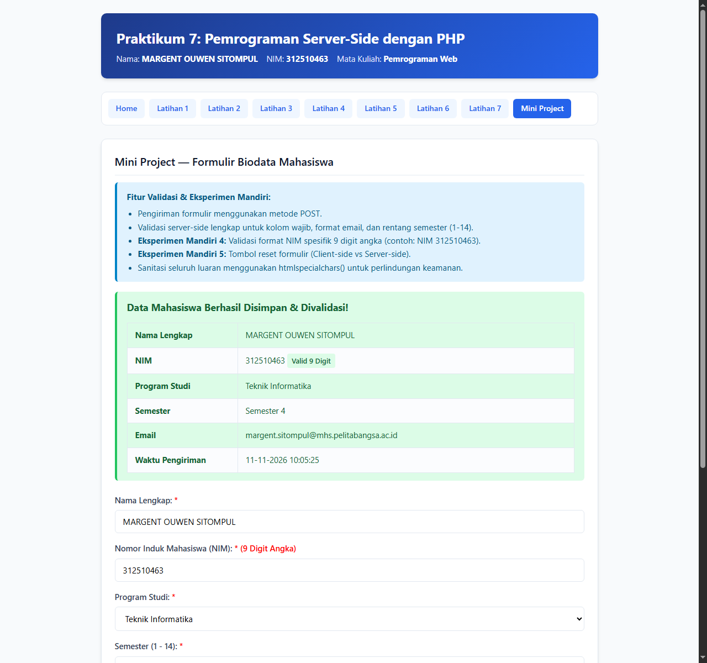

#### Kasus Valid 2 — Input Transaksi Barang dengan Harga Angka & Jumlah Bulat Positif (Latihan 7)
- **Input:**
  - Nama Barang: `SSD NVMe 512GB`
  - Harga: `650000`
  - Jumlah: `2`
- **Hasil Validasi:** Lolos pemeriksaan `is_numeric()` dan `ctype_digit()`. Sistem menampilkan ringkasan barang dan menghitung Subtotal sebesar `Rp 1.300.000` (lihat gambar Latihan 7 di atas).

---

### Dua Kasus Input Tidak Valid (Ditolak oleh Validasi Server-Side)

#### Kasus Tidak Valid 1 — NIM Mengandung Huruf, Semester di Luar Rentang, dan Format Email Salah (Mini Project)
- **Input:**
  - Nama: `MARGENT OUWEN SITOMPUL`
  - NIM: `31251ABC` (mengandung huruf dan hanya 8 karakter)
  - Program Studi: `Teknik Informatika`
  - Semester: `16` (melebihi batas maksimal 14)
  - Email: `email_salah` (tanpa format domain email yang benar)
- **Hasil Validasi:** Ditolak oleh server. Sistem menampilkan daftar pesan kesalahan:
  1. *"NIM harus berupa 9 digit angka (contoh: 312510463)."*
  2. *"Format email tidak valid (contoh yang benar: nama@domain.com)."*
  3. *"Semester harus berupa bilangan bulat antara rentang 1 sampai 14."*

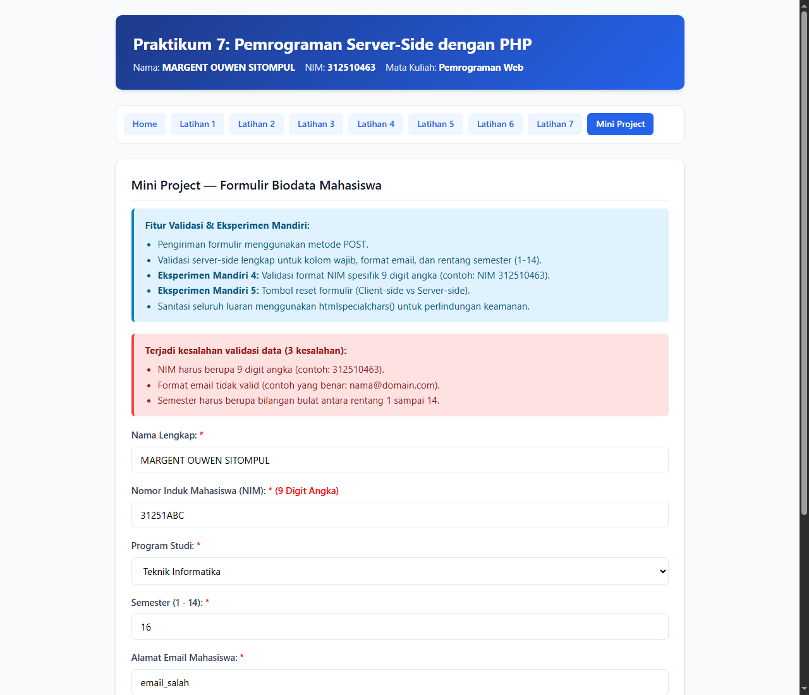

#### Kasus Tidak Valid 2 — Nama Barang Kosong, Harga Negatif, dan Jumlah Nol (Latihan 7)
- **Input pada Latihan 7:**
  - Nama Barang: *(kosong)*
  - Harga: `-5000`
  - Jumlah: `0`
- **Hasil Validasi:** Pemeriksaan server-side menangkap bahwa nama barang kosong, harga `< 0`, dan jumlah `< 1`, sehingga menolak perhitungan subtotal dan menampilkan pesan peringatan kesalahan validasi.

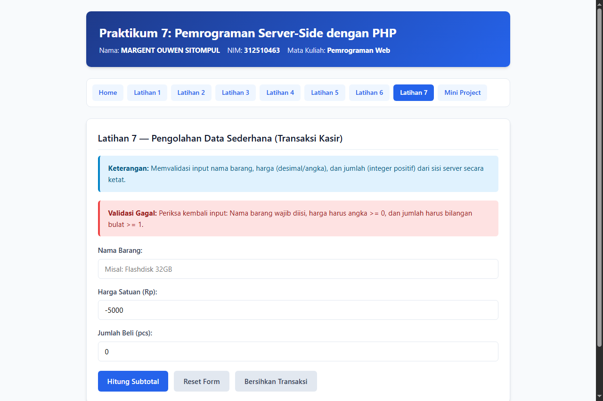

---

## G. Pembahasan Eksperimen Mandiri

1. **Perhitungan Nilai Rata-Rata dari Tiga Komponen Nilai (`latihan2.php`):**
   Ditambahkan rumus `$rataRata = ($tugas + $uts + $uas) / 3;` untuk membandingkan rata-rata murni dengan nilai akhir berbobot (`30% Tugas + 30% UTS + 40% UAS`).
2. **Pencarian Nama dari Array Data Sederhana Menggunakan GET (`latihan5.php`):**
   Menggunakan fungsi `stripos($mhs, $kata)` di dalam `foreach` untuk menyaring elemen array `$dataMahasiswa` yang cocok dengan kata kunci yang dikirimkan lewat URL parameter `?kata=...`.
3. **Function Mengubah Format Harga Menjadi Rupiah (`latihan4.php` & `latihan7.php`):**
   Dibuat fungsi `formatRupiah($angka)` yang membungkus `"Rp " . number_format($angka, 0, ",", ".")` agar dapat dipanggil berulang kali secara konsisten.
4. **Validasi NIM Hanya Berisi Angka dan Panjang Tertentu (`mini_project.php`):**
   Menggunakan Regular Expression `preg_match('/^[0-9]{9}$/', $nim)` yang memastikan NIM hanya terdiri dari digit angka (`0-9`) dan memiliki panjang tepat 9 karakter (sesuai format NIM `312510463`).
5. **Perbedaan Tombol Reset pada Form (`type="reset"`) dengan Pemrosesan Ulang di Server:**
   - **Tombol Reset (`<button type="reset">`)**: Dijalankan sepenuhnya di sisi *client* (browser) tanpa melakukan request ke server. Fungsinya hanya mengembalikan isi field input ke nilai atribut `value` awal yang ter-render di HTML. Jika form sebelumnya sudah disubmit ke server dan PHP mencetak nilai `value="<?php echo $nama; ?>"`, maka tombol `reset` hanya akan mengembalikan input ke nilai terakhir yang dikirim tersebut, bukan mengosongkannya.
   - **Pemrosesan Ulang di Server (`<a href="mini_project.php">`)**: Memicu permintaan HTTP `GET` baru ke server sehingga skrip PHP dijalankan dari awal dengan metode selain `POST`. Seluruh variabel `$data`, `$error`, dan variabel input diinisialisasi ulang menjadi kosong (`""`), sehingga baik form maupun pesan hasil kembali bersih sepenuhnya.

---

## H. Jawaban Pertanyaan Evaluasi

### 1. Apa perbedaan pemrosesan client-side dan server-side?
- **Client-side processing** adalah proses eksekusi kode (seperti HTML, CSS, dan JavaScript) yang dijalankan langsung di dalam web browser milik pengguna. Kode sumbernya dapat dilihat langsung oleh pengguna melalui fitur *View Page Source* atau *Inspect Element*.
- **Server-side processing** adalah proses eksekusi kode (seperti PHP) yang dijalankan di komputer server sebelum hasilnya dikirim ke pengguna. Server memproses logika bisnis, perhitungan, validasi, atau akses basis data, lalu hanya mengirimkan hasil akhirnya (berupa dokumen HTML) ke browser klien. Kode PHP asli tidak pernah terlihat oleh pengguna.

### 2. Mengapa file PHP harus dijalankan melalui web server?
Karena browser web hanya memahami HTML, CSS, dan JavaScript, serta tidak memiliki *PHP Interpreter* (mesin penerjemah PHP). Ketika file `.php` dibuka langsung lewat klik ganda (`file:///...`), kode PHP tidak akan diterjemahkan melainkan hanya dianggap sebagai teks biasa. Web server (seperti Apache, Nginx, atau PHP Built-in Server) bertugas meneruskan permintaan file `.php` ke modul *PHP Zend Engine* untuk dieksekusi, baru kemudian mengirimkan luaran HTML-nya ke browser melalui protokol HTTP (`http://localhost/...`).

### 3. Apa fungsi tanda `$` pada variabel PHP?
Tanda dolar (`$`) di PHP berfungsi sebagai penanda sintaksis (*identifier prefix*) untuk mendeklarasikan dan mengakses sebuah variabel (contoh: `$nama`, `$nim`, `$nilaiAkhir`). Tanda ini memungkinkan parser PHP membedakan dengan cepat antara variabel, konstanta, nama fungsi, maupun kata kunci (*keyword*) bahasa PHP, termasuk saat melakukan interpolasi variabel di dalam string bertanda kutip ganda (`"Halo $nama"`).

### 4. Apa perbedaan metode GET dan POST?
- **Metode GET:** Mengirimkan data formulir dengan cara menempelkannya pada URL sebagai *query string* (contoh: `cari.php?kata=MARGENT`). Memiliki batasan panjang karakter pada URL, data terlihat jelas di *address bar* serta riwayat browser, dapat di-*bookmark*, dan cocok digunakan untuk pengambilan/pencarian data yang tidak mengubah keadaan server (*idempotent*).
- **Metode POST:** Mengirimkan data formulir di dalam bagian *body* dari permintaan HTTP (*HTTP Request Body*), sehingga tidak ditampilkan di URL. Dapat mengirimkan data berukuran besar (termasuk unggahan file), lebih aman untuk mengirimkan data sensitif (seperti kata sandi atau formulir pendaftaran), serta digunakan untuk aksi yang menyimpan atau mengubah data di server.

### 5. Mengapa input pengguna perlu divalidasi di sisi server?
Validasi di sisi klien (seperti atribut HTML `required`, `type="email"`, `min`, `max`, atau validasi JavaScript) sangat mudah dilewati (*bypass*) oleh pengguna—misalnya dengan mematikan JavaScript, mengubah elemen HTML lewat *Inspect Element*, atau mengirim request HTTP langsung menggunakan *tools* seperti Postman/cURL. Oleh karena itu, validasi sisi server dengan PHP merupakan benteng pertahanan utama untuk menjamin integritas data, mencegah kerusakan logika aplikasi, dan melindungi sistem dari input berbahaya.

### 6. Apa fungsi `htmlspecialchars()` ketika menampilkan data dari form?
Fungsi `htmlspecialchars()` mengubah karakter-karakter khusus HTML seperti `<`, `>`, `&`, `"`, dan `'` menjadi entitas HTML yang aman (`&lt;`, `&gt;`, `&amp;`, `&quot;`, `&#039;`). Fungsinya adalah mencegah celah keamanan **Cross-Site Scripting (XSS)**, yaitu kondisi ketika pengguna menyisipkan tag HTML atau kode `<script>` berbahaya ke dalam form. Dengan `htmlspecialchars()`, skrip berbahaya tersebut hanya akan ditampilkan sebagai teks biasa di layar browser dan tidak dieksekusi sebagai kode program.

### 7. Apa manfaat penggunaan function dalam program PHP?
- **Modularitas & Reusabilitas (*Code Reuse*):** Kode cukup ditulis satu kali di dalam fungsi dan dapat dipanggil berkali-kali di berbagai tempat tanpa menduplikasi kode (*Don't Repeat Yourself / DRY*).
- **Kemudahan Pemeliharaan (*Maintainability*):** Jika ada perubahan rumus atau aturan format (misalnya perubahan format Rupiah atau rumus diskon), perubahan cukup dilakukan di satu fungsi saja.
- **Keterbacaan Kode (*Readability*):** Memecah program yang panjang menjadi blok-blok logika kecil yang memiliki nama deskriptif (seperti `hitungDiskon()`, `formatRupiah()`, `tentukanKelulusan()`), sehingga alur program jauh lebih mudah dipahami dan di-*debug*.
